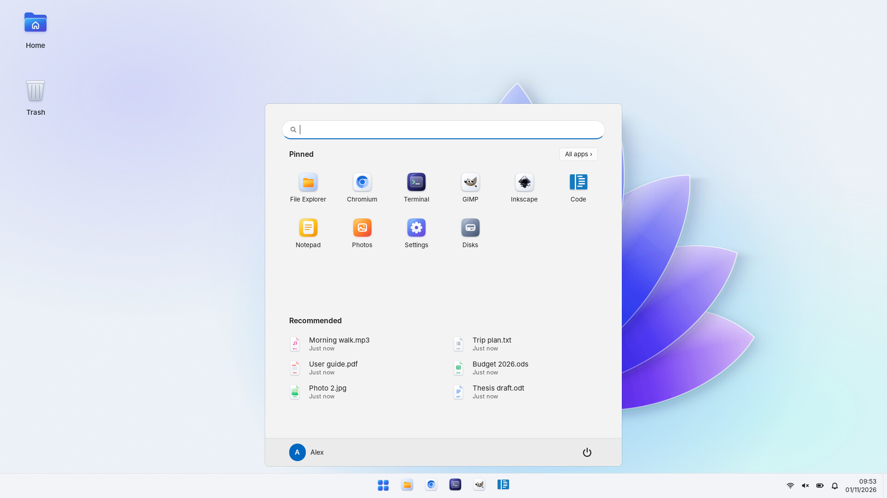
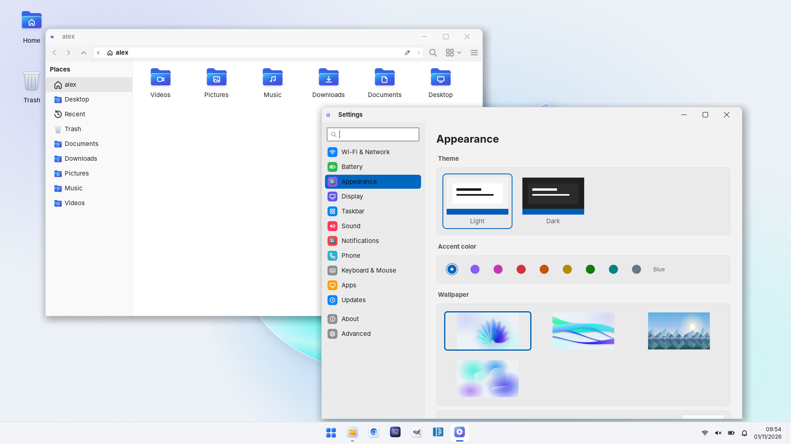
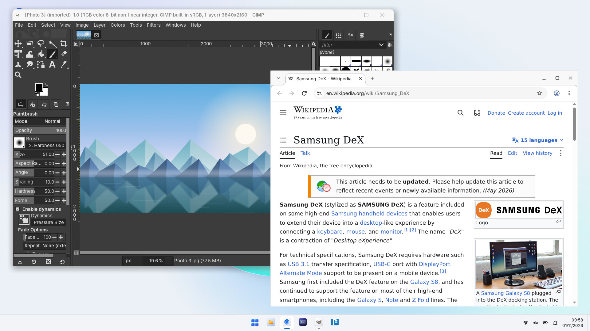

# Termux On DeX 2

[Italiano](README.md) · **English**

A Linux desktop for Android phones, made for using the phone with Samsung DeX on an
external monitor. No root needed.

It's built on Termux with Termux:X11 and XFCE. Apps that Termux doesn't have come from a
Debian container, and graphics run on the phone's GPU. The name comes from Samsung's old
*Linux on DeX*, which no longer exists.

It's still an alpha. I've tested it on a Galaxy S26 Ultra (Snapdragon, Adreno GPU) and a
Galaxy S20+ (Exynos, Mali GPU); it should work on any 64-bit Android 8 or later. If
something doesn't work, open an issue and attach the file that `tod doctor` creates.



The installer and the project's own windows are in English, or in Italian on a phone set
to Italian. XFCE and the apps follow the phone's language.

## Installation

You need Termux from [GitHub](https://github.com/termux/termux-app/releases) (the
`...arm64-v8a.apk` file): the Play Store version won't work. On Samsung phones, turn off
Auto Blocker (Settings → Security and privacy), otherwise Android won't let you install
APKs or turn on wireless debugging.

Then, in Termux:

```sh
bash <(curl -fsSL https://raw.githubusercontent.com/PietroCav501/termux_on_dex/v2/install.sh)
```

Add `--yes` at the end to skip the questions and use the default choices.

It takes 30-40 minutes and about 8 GB of free space. If the installation stops, run the
same command again: it picks up from the step where it stopped.

At the start you're asked to connect the phone's wireless ADB to itself. This stops Android
from closing the desktop ("Process completed (signal 9)") and lets the installer set up
Termux:X11 and Termux:API on its own. Wireless debugging only works while the phone is
connected to a Wi-Fi network (not while it's acting as a hotspot). You can skip it and do it
later with `tod phantom`; on Android 14 and later you can instead turn on "Disable child
process restrictions" in Developer options.

## What's included

- Its own theme, icons, pointer and wallpapers (DeX OS), light or dark, in the color you
  pick.
- Start menu, a taskbar with window previews, and panels for notifications, volume,
  calendar, battery, memory and network.
- Settings and package updates in their own windows.
- A file manager with the phone's folders: Documents, Downloads, Pictures, Music, Videos.
- USB sticks, drives and SD cards, read and write (ext4, exFAT, FAT, NTFS), with eject and
  a tool to format them. No root: the drives are read by the Linux kernel built as a
  library ([LKL](https://github.com/lkl/linux)). `lsblk`, `fdisk` and `mkfs` work from the
  terminal too.
- One `apt`: `sudo apt install gimp` takes the Termux package if there is one, otherwise
  the Debian one, and the app shows up in the Start menu only once.
- The phone's Android apps in the Start menu, opening in a DeX window.
- Phone battery, network and notifications in the taskbar (with Termux:API).
- Firefox and LibreOffice.





XFCE runs directly in Termux. Debian apps start without proot when they can: Debian's
loader, patched for Android, together with [fakechroot](https://github.com/dex4er/fakechroot)
is enough to show the app the container's files, and graphics run about twice as fast.
Apps that don't start this way fall back to proot by themselves; `tod diretto off` turns
this mode off.

With Termux from GitHub, the installer sets up a modified Termux:X11 that composites
windows on the GPU (glamor). The changes and the scripts to rebuild it are in `x11/`; the
APK and the full sources are in the releases.

## Known limits

- Mali GPUs (Exynos, MediaTek): OpenGL goes through virgl, but there's no accelerated
  Vulkan driver without root, so Vulkan apps run on the CPU. Adreno GPUs get Turnip.
- The first time you plug in a USB stick, Android asks for permission.
- Android handles the network: to change Wi-Fi, the panel opens the phone's settings. The
  network name only shows with Location turned on.
- Under load the phone heats up and slows itself down. In DeX it's best kept charging and
  somewhere cool.

## Commands

You don't need them for normal use:

```
tod start | stop | restart | status   the desktop
tod doctor                            diagnostics (also saved to Download/tod-doctor.txt)
tod prestazioni                       CPU, memory and temperature for one minute
tod update                            update Termux On DeX
tod menu                              control center
tod gpu [status|probe|bench]          graphics acceleration
tod display [auto|<dpi>]              text and icon size
tod phantom                           connect ADB for the "signal 9" fix
tod cx pkexec off                     Debian apps stop asking for the admin password
tod telefono [aggiorna|spento|acceso] the phone's apps in the Start menu
tod uninstall                         remove everything
```

Logs are in `~/.local/state/tod/`: `tod.log` for the installation and commands,
`session.log` for the desktop, `usb.log` for USB sticks and cards.

## Development

```sh
bash tests/run.sh                      # the tests, run on any Linux
python3 tests/lint_errexit.py tod install.sh lib/*.sh
```

`tod` and `lib/` are bash; the windows (Start menu, taskbar, panels, Settings, installer,
drives in `share/usb/`) are Python with GTK 3. The DeX OS theme is generated from
`share/dexos/`. Comments in the code are in Italian.

## Credits

[Termux](https://termux.dev), [Termux:X11](https://github.com/termux/termux-x11),
[Termux:API](https://github.com/termux/termux-api), [proot-distro](https://github.com/termux/proot-distro),
[fakechroot](https://github.com/dex4er/fakechroot), [LKL](https://github.com/lkl/linux),
[lfdevs](https://github.com/lfdevs) for the Mesa Freedreno-KGSL packages, the Mesa project
(Freedreno, Turnip, Zink, virgl), the [Fluent](https://github.com/vinceliuice/Fluent-gtk-theme)
theme that DeX OS's theme starts from, and the [Inter](https://rsms.me/inter/) font.

## License

[GNU GPL version 3](LICENSE). Packages downloaded during the installation keep their own
licenses.
