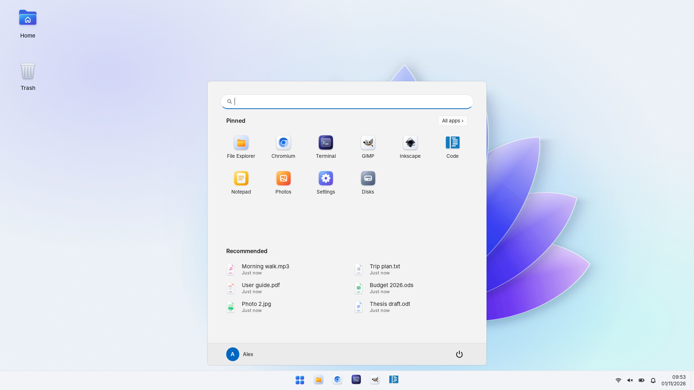
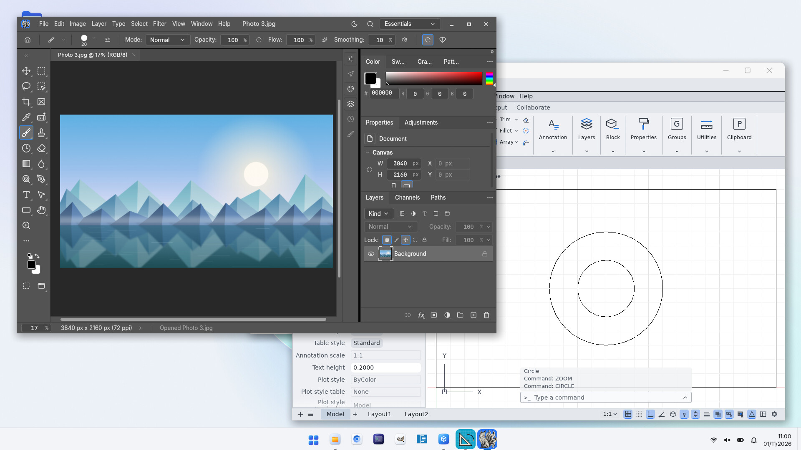
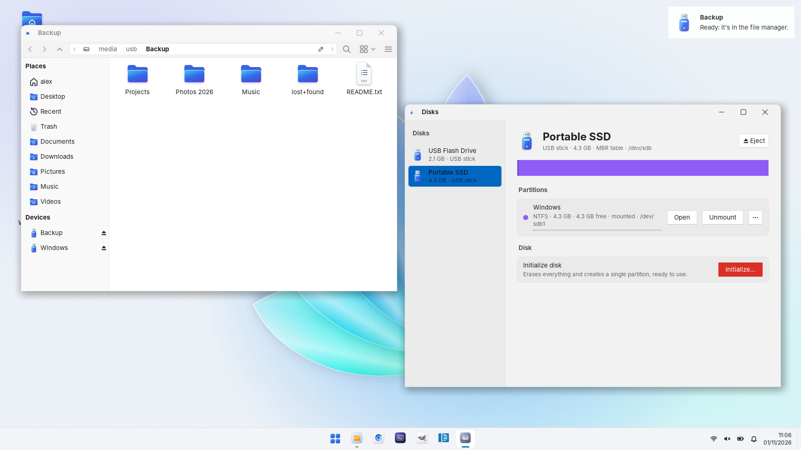
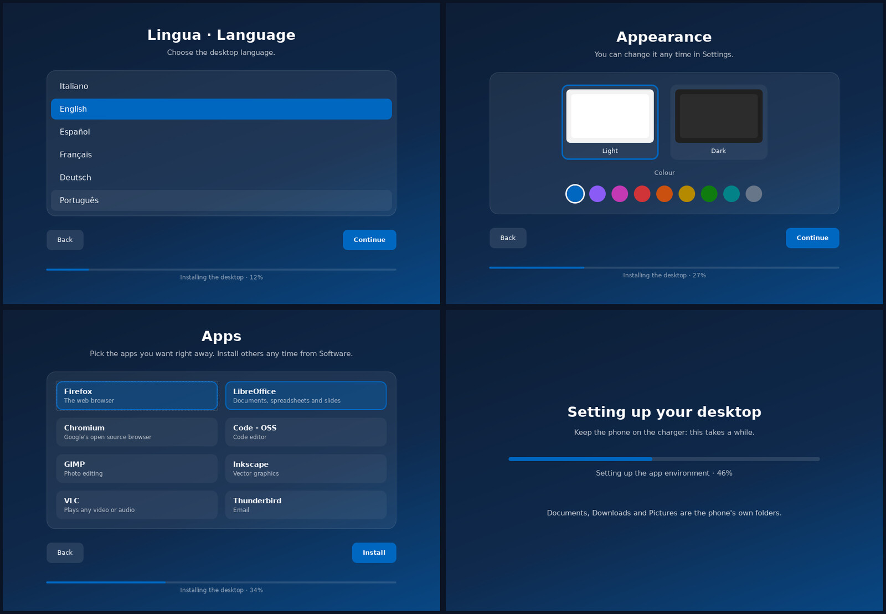
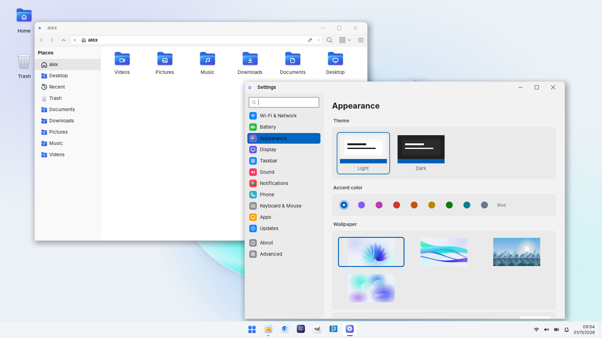
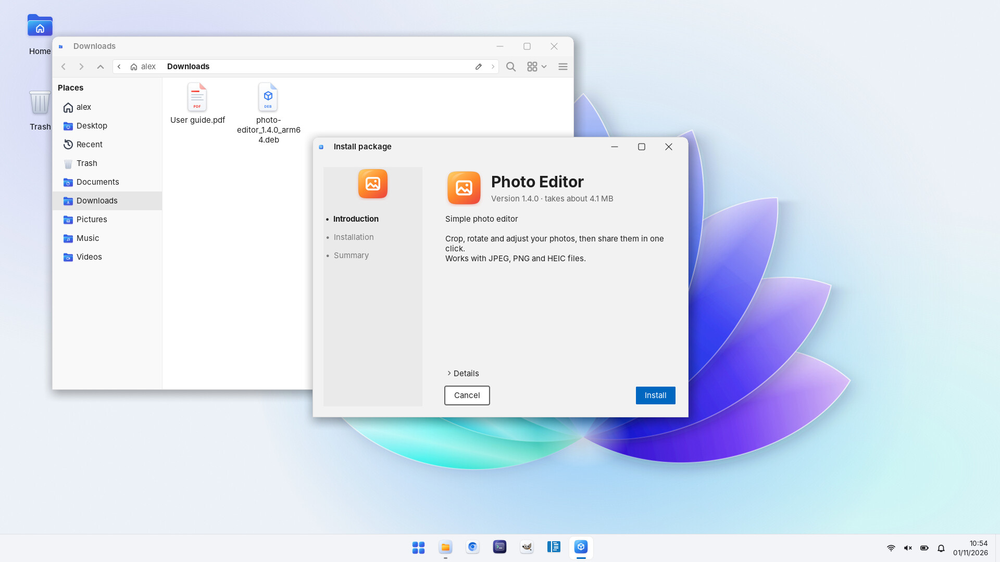

# Termux On DeX 2

**Italiano** · [English](README.en.md)

Un desktop Linux per telefoni Android, fatto per usare il telefono con Samsung DeX
collegato a un monitor. Non serve il root.

La base è Termux con Termux:X11 e XFCE, e quasi tutto gira direttamente su Android, senza
proot. Le app che Termux non ha arrivano da un container Debian, ma partono anche loro senza
proot. Il nome viene dal vecchio *Linux on DeX* di Samsung, che non esiste più.

È ancora una alpha. L'ho provato su un Galaxy S26 Ultra (Snapdragon, GPU Adreno) e su un
Galaxy S20+ (Exynos, GPU Mali); dovrebbe andare su qualsiasi Android 8 o successivo a 64 bit.
Se qualcosa non funziona apri una issue e allega il file che crea `tod doctor`.



## Cosa lo rende diverso

Molti script per Termux mettono il desktop dentro proot, che ferma il programma a ogni
chiamata al sistema. Qui proot serve quasi solo per installare i pacchetti.

- XFCE, la barra, lo Start e le app di Termux sono programmi Android veri, compilati per
  Termux.
- Anche le app di Debian partono senza proot: il caricatore di Debian, corretto per
  Android, e [fakechroot](https://github.com/dex4er/fakechroot) fanno vedere all'app i file
  del container senza fermarla. Misure sul Galaxy S26 Ultra: 200.000 letture di file in
  0,13 secondi invece di 10; glxgears da circa 310 a circa 650 fotogrammi al secondo;
  un'app Electron si apre in 1,1 secondi invece di 2,6 e usa il 36% di processore e il 20%
  di memoria in meno. Le poche app che così non partono tornano su proot da sole.
- Chiavette USB, dischi e schede SD senza root. Android non dà i dischi USB alle app: qui
  li legge il kernel Linux vero, compilato come libreria ([LKL](https://github.com/lkl/linux))
  e avviato dentro Termux. ext4, exFAT, FAT e NTFS in lettura e scrittura; per le app sono
  cartelle normali in `/media/usb`.
- Termux:X11 con la composizione delle finestre sulla GPU (glamor), mentre la versione
  ufficiale la fa con il processore. Le modifiche sono in `x11/`, l'APK e i sorgenti nelle
  release. Si installa da sola con Termux da GitHub.
- Un solo `apt` per Termux e Debian: `sudo apt install gimp` prende il pacchetto di Termux
  se c'è, altrimenti quello di Debian, e ogni app è installata una volta sola.
- Il telefono dentro il desktop: le app Android nello Start con le loro icone, e batteria,
  rete e notifiche del telefono nella barra.
- Il driver della GPU lo sceglie l'installazione con una prova vera sul telefono.





## Installazione

Serve Termux scaricato da [GitHub](https://github.com/termux/termux-app/releases) (il file
`...arm64-v8a.apk`): quello del Play Store non va bene. Sui Samsung bisogna spegnere il
Blocco automatico (Impostazioni → Sicurezza e privacy), altrimenti Android non lascia
installare gli APK e non attiva il debug wireless.

Poi in Termux:

```sh
bash <(curl -fsSL https://raw.githubusercontent.com/PietroCav501/termux_on_dex/v2/install.sh)
```

Aggiungendo `--yes` in fondo non fa domande e usa le scelte predefinite.

Ci vogliono 30-40 minuti e circa 8 GB liberi. Se l'installazione si interrompe basta
rilanciare lo stesso comando: riprende dal passo in cui si era fermata.

Dopo i primi passi in Termux l'installazione continua a tutto schermo: si scelgono lingua,
nome, aspetto e app mentre dietro si installa tutto.



All'inizio viene chiesto di collegare l'ADB wireless del telefono a sé stesso. Serve a
evitare che Android chiuda il desktop ("Process completed (signal 9)") e a installare da
sole Termux:X11 e Termux:API. Il debug wireless funziona solo con il telefono connesso a
una rete Wi-Fi (non mentre fa da hotspot). Si può saltare e farlo dopo con `tod phantom`;
da Android 14 in poi basta anche attivare "Disable child process restrictions" nelle
Opzioni sviluppatore.

## Cosa c'è

- Tema, icone, puntatore e sfondi propri (DeX OS), chiari o scuri, nel colore che scegli.
- Menu Start, barra delle applicazioni con le anteprime delle finestre, pannelli per
  notifiche, volume, calendario, batteria, memoria e rete.
- Impostazioni e aggiornamenti dei pacchetti con una finestra propria.
- Esplora file con le cartelle del telefono: Documenti, Download, Immagini, Musica, Video.
- Chiavette e schede in Esplora file con l'espulsione, un programma per formattarle, e dal
  terminale `lsblk`, `fdisk` e `mkfs`.
- Doppio clic su un file `.deb` per installarlo, come i `.pkg` sul Mac: l'installer capisce
  da solo se va in Termux o in Debian.
- Le app Android si aprono in una finestra di DeX; per batteria, rete e notifiche del
  telefono serve Termux:API, che l'installazione mette da sola.
- Desktop in italiano (anche XFCE, che su Termux di solito resta in inglese), Firefox e
  LibreOffice.





## Limiti

- GPU Mali (Exynos, MediaTek): OpenGL passa da virgl, ma per Vulkan non c'è un driver
  accelerato senza root e le app Vulkan girano sul processore. Sulle Adreno c'è Turnip.
- La prima volta che colleghi una chiavetta Android chiede il permesso.
- La rete la gestisce Android: per cambiare Wi-Fi si aprono le sue impostazioni dal
  pannello. Il nome della rete si vede solo con la Posizione accesa.
- Sotto carico il telefono si scalda e rallenta da solo. In DeX conviene tenerlo in
  carica e al fresco.

## Comandi

Per l'uso normale non servono:

```
tod start | stop | restart | status   il desktop
tod doctor                            diagnosi (salva anche Download/tod-doctor.txt)
tod prestazioni                       processore, memoria e calore per un minuto
tod update                            aggiorna Termux On DeX
tod menu                              centro di controllo
tod gpu [status|probe|bench]          accelerazione grafica
tod display [auto|<dpi>]              grandezza di testo e icone
tod phantom                           collega ADB per il "signal 9"
tod cx pkexec off                     le app di Debian non chiedono più la password di amministratore
tod telefono [aggiorna|spento|acceso] le app del telefono nello Start
tod uninstall                         toglie tutto
```

I registri sono in `~/.local/state/tod/`: `tod.log` per installazione e comandi,
`session.log` per il desktop, `usb.log` per chiavette e schede.

## Sviluppo

```sh
bash tests/run.sh                      # i test, girano su qualsiasi Linux
python3 tests/lint_errexit.py tod install.sh lib/*.sh
```

`tod` e `lib/` sono in bash; le finestre (Start, barra, pannelli, Impostazioni,
installazione, dischi in `share/usb/`) in Python con GTK 3. Il tema DeX OS si genera da
`share/dexos/`.

## Crediti

[Termux](https://termux.dev), [Termux:X11](https://github.com/termux/termux-x11),
[Termux:API](https://github.com/termux/termux-api), [proot-distro](https://github.com/termux/proot-distro),
[fakechroot](https://github.com/dex4er/fakechroot), [LKL](https://github.com/lkl/linux),
[lfdevs](https://github.com/lfdevs) per i pacchetti Mesa Freedreno-KGSL, il progetto Mesa
(Freedreno, Turnip, Zink, virgl), il tema [Fluent](https://github.com/vinceliuice/Fluent-gtk-theme)
da cui parte quello di DeX OS e il carattere [Inter](https://rsms.me/inter/).

## Licenza

[GNU GPL versione 3](LICENSE). I pacchetti scaricati durante l'installazione hanno le loro
licenze.
